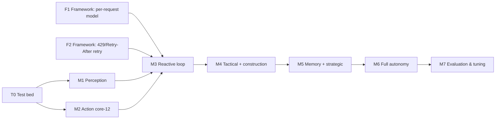

# 07 — Roadmap: an LLM that plays RimWorld on its own

**Status:** execution roadmap. Specs stay in `00`–`06` (`06` wins on conflicts); this file orders the work, fixes each milestone's exit test, and names what to reuse.
**Goal:** start a colony, leave the keyboard, and the LLM keeps it alive and growing — drafting for raids, assigning work, building, researching — with no human input.

## 1. Where we are (2026-11-27)

| Piece | State |
|---|---|
| `RimAI.Framework` (LLM plumbing) | Working in RimWorld 1.6.4871. Chat (non-stream + stream), tool calls, JSON mode, embeddings, usage fields (`UsageInfo` — old M0.5/G-01 is done). |
| Local LLM endpoint | Built-in provider **Local Proxy 8787** (`http://127.0.0.1:8787/v1`, keyless). Chat `beam-free`, embeddings `qwen3-embedding-8b` (4096-d). Verified in-game. |
| `RimAI.Agent` (the player) | Skeleton only: ~1.9k lines, 452 `TODO(impl)`, 27 `NotImplementedException`. Not deployed by its build; game component never registered. |
| Harmony | Needed by Agent (planned event hooks) — `../HarmonyRimWorld` has a 1.6 build; not installed in `Mods/`. |
| Reuse sources (MIT, attribute) | `../Rimworld_AI_Core` (scheduler, ~30 world-data readers, tool registry) — see `docs/research/rimai-core.md`. RimMind (context trimming, action registry/risk tiers, memory tiers) — see `docs/research/rimmind-*.md`. Neither has colony-management actions or an autonomous loop. |
| Audit `06` status | Already done in code: G-01 (`UsageInfo` + usage parsing in chat/embedding/stream translators), G-05 (Agent csproj `Lib.Harmony` 2.3.3; About.xml Harmony dependency + loadAfter), G-06 (`RimAI.Agent.Tests` with serialization + usage-parser tests; `raf-qx3` still needs a test run). Other gaps open. |
| Beads | New items T0, F1, F2, M7 below are **not yet filed** — `bd` is not installed on this machine. File them with deps M1/M2→T0, M3→F1, M3→F2, M7→M6. |

## 2. Milestones

Every milestone ends with: green `dotnet build`, unit tests for game-free logic, and an **unattended in-game run** whose result is read from `Player.log` (no UI clicking). Agent beads epics are listed per milestone.

### T0 — Test bed (new; prerequisite for everything)
Without a repeatable unattended game, no later exit test can be run.
- Install Harmony into `/Applications/RimWorld.app/Mods/` and order `brrainz.harmony` first in `ModsConfig.xml`.
- Agent post-build deploy to `Mods/RimAI_Agent` (mirror the Framework's `PostBuild` target; honour `RIMWORLD_DIR`); load order Harmony → Framework → Agent.
- Register `AgentGameComponent` (fixes the `GameComponentUpdate` that currently throws) with a heartbeat log line every in-game hour.
- Auto-start a colony: launch with RimWorld's `-quicktest` argument (dev quick-test map) — **verify on 1.6 first**; fallback is a committed baseline save auto-loaded by a dev startup hook.
- Telemetry line every in-game day: `colonists alive, downed, food-days, avg mood, wealth, research done, fires, active threats` → this becomes the scoreboard for M3–M7.
- Script `scripts/run-colony.sh`: build → deploy → launch → stop after N in-game days or wall-clock limit → extract telemetry.
- **Exit:** one command boots a fresh colony with Agent loaded and prints 3 in-game days of telemetry, unattended.

### F1 — Framework gap: per-request model (new, small)
`UnifiedChatRequest` has no model/provider field; `ChatManager` always uses `ActiveChatProviderId` and that provider's model, so tiers cannot use different models. Add optional `Model` (and optional `ProviderId`) on the request, threaded through `MergedChatConfig` → translator; the cache key already includes `cfg.Model`, so it must read the effective (overridden) model. Null keeps current behaviour. Unit test translator + cache key.
- **Exit:** two requests in one session hit two different models on 8787 (log shows both).

### F2 — Framework gap: HTTP-status-aware retry (new, small; before M3 uses cloud models)
`HttpExecutor.ExecuteAsync` returns `Success` for any HTTP status and retries only transport errors/timeouts; there is no 429/5xx retry and no `Retry-After` handling. Retry 429/502/503/504 with exponential backoff, honour `Retry-After` (seconds or HTTP date) capped by the policy, never retry other 4xx. Unit test with a fake handler.
- **Exit:** a stub server returning 429 + `Retry-After: 2` then 200 yields one success after ≥ 2 s; a 400 is not retried.

### M1 — Perception · `raf-jo2`
Spec: `01-perception.md` + `06` G-02/G-03/G-05/G-07.
- Port Core's `SchedulerService`/`SchedulerGameComponent` pattern for main-thread reads; adapt its `World/Parts/*` readers into `ColonySnapshot` v2 (pawns, needs, health, resources, buildings, zones, bills, policies, factions, threats).
- `EntityId` minting shared with Action (G-03).
- EventBus from Harmony postfixes on letters/alerts/damage/deaths (read-only, `Priority.Last`).
- Token-budget trimmer with protected core sections (RimMind context pattern).
- **Exit:** on the T0 colony, a snapshot JSON ≤ 5,500 tokens is logged every in-game hour and a dev-spawned raid produces a `PerceptionEvent`.

### M2 — Action, core-12 commands · `raf-ad9`
Spec: `03-action.md` + `06` G-13/G-14/G-16/G-28.
- Command queue drained on main thread, `Dictionary<string, ICommandHandler>` registry with risk tier (RimMind pattern), schema validation, structured `CommandResult` with `FailureCategory`, post-execution verifier.
- Core-12 per `06` G-13: DraftColonist, UndraftColonist, MoveTo, AttackTarget, SetWorkPriority, AddBill, RemoveBill, CreateZone (growing + stockpile), AddDesignation, RescueColonist, TendPawn, CancelCommand. Plant-to-grow, suspend bill, research project etc. follow in M3–M5 as G-13 phases them.
- **Exit:** a scripted JSON command file (no LLM) sets work priorities, adds and removes a bill, creates a stockpile and a grow zone, designates trees to chop, drafts/moves/undrafts a colonist on the T0 colony; verifier reports all succeeded.

### M3 — Reactive loop (first autonomous behaviour) · `raf-2vs`
Spec: `02-cognition.md` reactive tier + `05` + `06` G-15/G-17/G-18.
- EventBus → reactive planner (tool-calling over 8787, fast model) → validated commands → queue. Circuit breaker on LLM failures; never blocks the game thread.
- **Exit:** 3 dev-spawned raids on the T0 colony; AI drafts, fights and undrafts each time unattended; ≥ 2/3 raids end with no colonist death.

### M4 — Tactical planner + construction · `raf-ajz`
Spec: `02` tactical tier + `06` G-04 (blueprints, floors, plant-to-grow, prisoner interaction).
- Every ~6 in-game hours: work priorities, bills, zones, hauling, medical; place blueprints for beds, walls, freezer, workbenches.
- **Exit:** T0 colony runs **5 in-game days** with zero human input: no starvation, every colonist has a bed, at least one food bill active.

### M5 — Memory + strategic planner · `raf-aqc`
Spec: `04-memory.md` + `02` strategic tier.
- Episodic log with embeddings via Framework (`qwen3-embedding-8b`); **store model id with each vector** (dimension change otherwise breaks cosine similarity on old saves).
- Strategic tier every ~2 in-game days: research path, expansion, trade, recruitment, defense.
- **Exit:** over 15 in-game days, ≥ 3 strategic decisions cite a retrieved past episode in their logged rationale; research completes ≥ 3 projects.

### M6 — Full autonomy, guardrails, UI · `raf-d7i`
Spec: `05-orchestration.md`.
- Autonomy dial (advisor → full), per-day token/call budget with degradation Strategic → Tactical → Reactive, destructive-action guardrails, decision-log window.
- **Exit — "plays on its own":** fresh colony, **30 in-game days** unattended: ≥ 3 colonists alive, food ≥ 5 days stocked at end, survived every raid, wealth grew, budget never exceeded.

### M7 — Evaluation & tuning (new, ongoing)
- Batch runner over N seeds/storytellers using `run-colony.sh`; table of telemetry per run (survival days, deaths, wealth, research, tokens, cost).
- Model matrix per tier on 8787 (e.g. reactive: a fast non-reasoning model vs `beam-free`; strategic: strongest available) — choose by survival-per-token, not by feel.
- Regression gate: a prompt or code change must not lower median survival on the fixed seed set.

## 2a. RimMind patterns to adopt (by milestone)
Source analysis: `docs/research/rimmind-context.md`, `rimmind-actions.md`, `rimmind-memory.md`. MIT — copied code keeps an attribution header. Adopt the pattern, not the module: RimMind is text-only (no entity IDs), bool-only action results, recency-only memory — we keep our structured DTOs, `CommandResult`, and embedding retrieval.

| Pattern | RimMind source | Milestone | Why |
|---|---|---|---|
| Priority-protected token trim (core section untrimmable, numeric tiers) | RimMind-Core `PromptBudget` | M1 | Holds the snapshot ≤ 5.5K tokens without cutting threats/starving pawns |
| `ConcurrentQueue` hand-off drained on main thread each tick | RimMind-Core result/log queues | M1, M3 | Off-thread LLM results → game thread for EventBus and command queue |
| Event aggregation (repeated job/event → one session entry) | RimMind-Memory work sessions | M1 (EventBus), M5 | Stops repetitive events flooding prompts and memory |
| Name-keyed `Dictionary<string, ICommandHandler>` registry + `RiskLevel` per handler | RimMind-Actions `IActionRule`, `RimMindActionsAPI` | M2 | Extensible whitelist; risk tier drives guardrails |
| `[DebugAction]` per command, startup-registered | RimMind-Actions debug actions | M2 | Dev harness for the scripted no-LLM exit test (G-28) |
| `ExecuteBatch`: first step interrupts, rest queue on the same pawn | RimMind-Actions `ExecuteBatch` | M2 | Multi-step orders (draft → move → attack) |
| Request expiry (`ExpireAtTicks`) | RimMind-Core request queue | M3 | Drop reactive answers that arrive after the event ended |
| Per-action player enable/disable in ModSettings | RimMind-Actions settings | M2 (data), M6 (UI) | Player can forbid destructive commands |
| Per-event-type importance heuristics | RimMind-Memory | M5 | Seed `Episode.Importance` before LLM scoring |
| Pinned entries immune to decay/eviction | RimMind-Memory `isPinned` | M5 | Persist strategic goals |
| Daily LLM compression into long-term impressions | RimMind-Memory "dark" tier | M5 | Long history at low token cost — **append-only** (RimMind overwrites) |
| Deterministic jitter `Random(thingID ^ const)` | RimMind-Memory | M5 | Stagger embedding/summary batches |

Do **not** adopt: text-only context, bool action results, ad-hoc string parameter parsing, recency-only injection, unpersisted command queue, missing circuit breaker, fixed-cooldown retry without `Retry-After` (covered by F2 instead), coupling to a RimMind-Core equivalent.

## 3. Cross-cutting rules
- Threading, DTO-only cognition, schema-validated actions, budget cap, save compatibility: as `00` §3 — unchanged.
- In-game validation uses a temporary `[StaticConstructorOnStartup]` self-test or the T0 runner, read from `~/Library/Logs/Ludeon Studios/RimWorld by Ludeon Studios/Player.log`; temporary self-tests are deleted before commit.
- Reused code from Core/RimMind keeps an attribution header naming the source repo and file.

## 4. Open risks
| Risk | Mitigation |
|---|---|
| `-quicktest` behaviour on 1.6 unverified | T0 fallback: baseline save + dev auto-load hook |
| Reasoning models (`beam-free`) are slow / spend tokens thinking | F1 per-tier models; reactive tier on a fast model; M7 measures it |
| Snapshot too large for the prompt | Priority-protected trimming (M1), 5.5K ceiling as an exit check |
| Construction placement quality (bad blueprints) | Whitelisted ~40 buildings, cell validation, verifier; layout templates if raw placement fails |
| Proxy outage mid-run | Circuit breaker (M3) pauses AI, game continues; telemetry flags the gap |
